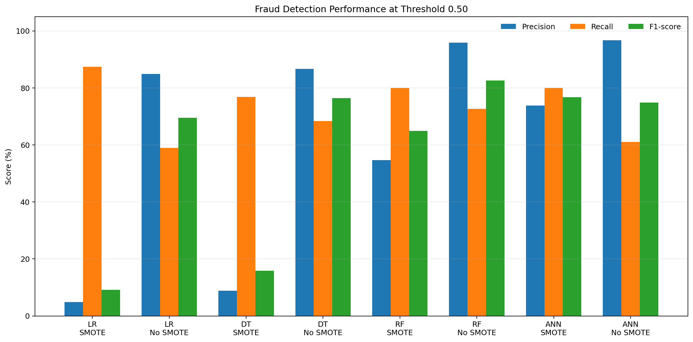
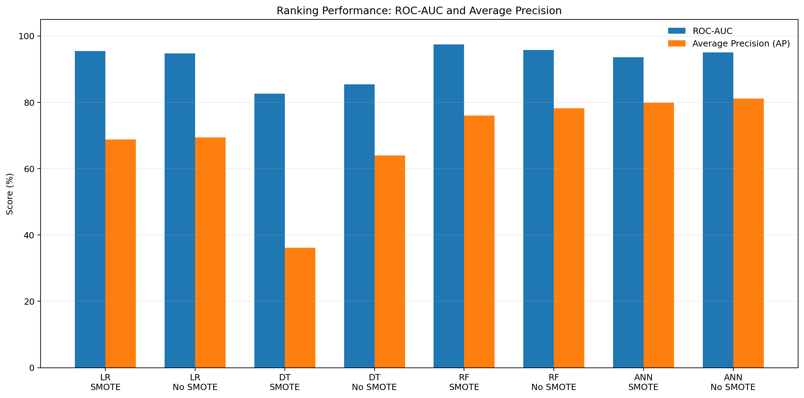
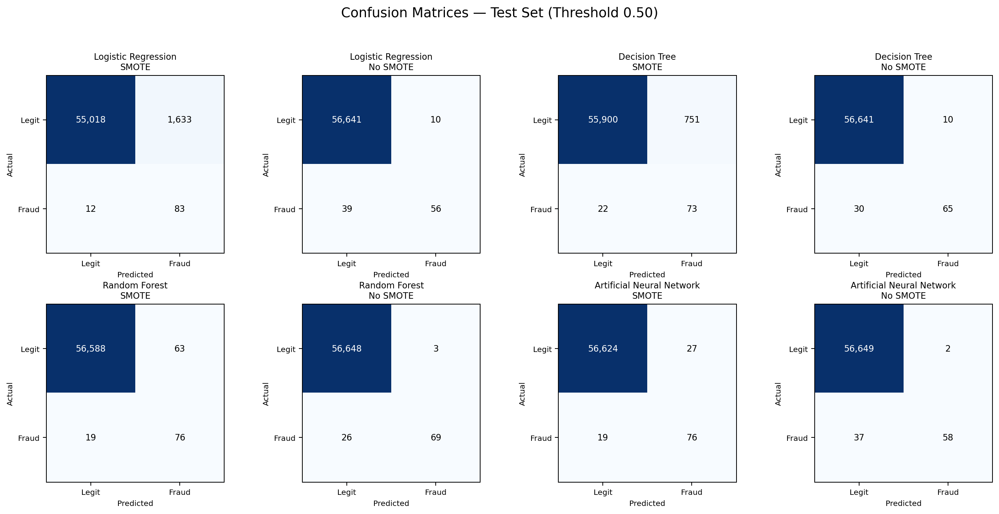

# Credit Card Fraud Detection using Machine Learning & Deep Learning

This project investigates how the Synthetic Minority Over-sampling Technique (SMOTE) affects credit-card fraud classification across three classical machine-learning algorithms and a feed-forward Artificial Neural Network (ANN).

The work includes exploratory data analysis, duplicate removal, feature standardization, imbalanced-data handling, model training, and evaluation on a held-out test set.

## Research question

**How does applying SMOTE to the training data affect precision, recall, F1-score, ROC-AUC, and Average Precision for different fraud-classification models?**

## Dataset and split

- Cleaned dataset: **283,726 transactions** with **30 input features** and the binary `Class` target.
- Split: **64% training (181,584 rows), 16% validation (45,396 rows), and 20% test (56,746 rows)**.
- Both splitting stages use stratification and `random_state=42`.
- `StandardScaler` is fitted on the training partition only, then applied to validation and test partitions.
- SMOTE is applied **only to the training partition** in the SMOTE experiments. Validation and test data retain their original class distribution.
- The held-out test set contains **95 fraud cases** and **56,651 legitimate cases**.

The raw and processed datasets are excluded by `.gitignore`. Provide the source CSV locally as `data/raw/creditcard.csv` before running the pipeline.

## Models

| Model | Configuration used |
|---|---|
| Logistic Regression | `random_state=42`, `max_iter=1000` |
| Decision Tree | `random_state=42`, `max_depth=10` |
| Random Forest | `random_state=42`, `n_estimators=30`, `max_depth=10`, `n_jobs=-1` |
| ANN | 30 inputs → Dense(67, ReLU) → Dense(1, Sigmoid); Adam; binary cross-entropy; 10 epochs; batch size 32 |

Each model was evaluated with and without SMOTE, giving eight experiments. The ANN uses the same training, validation, and test partitions; its SMOTE variant resamples only its training partition.

## Test-set results

All threshold-based metrics use the default classification threshold **0.50**. ROC-AUC and Average Precision use prediction scores/probabilities. Values are percentages.

| Model | Imbalance treatment | Accuracy | Precision | Recall | F1-score | ROC-AUC | AP |
|---|---|---:|---:|---:|---:|---:|---:|
| Logistic Regression | SMOTE | 97.10% | 4.84% | 87.37% | 9.17% | 95.41% | 68.77% |
| Logistic Regression | No SMOTE | 99.91% | 84.85% | 58.95% | 69.57% | 94.70% | 69.39% |
| Decision Tree | SMOTE | 98.64% | 8.86% | 76.84% | 15.89% | 82.60% | 36.11% |
| Decision Tree | No SMOTE | 99.93% | 86.67% | 68.42% | 76.47% | 85.38% | 63.96% |
| Random Forest | SMOTE | 99.86% | 54.68% | 80.00% | 64.96% | 97.40% | 76.05% |
| Random Forest | No SMOTE | 99.95% | 95.83% | 72.63% | 82.63% | 95.74% | 78.19% |
| Artificial Neural Network | SMOTE | 99.92% | 73.79% | 80.00% | 76.77% | 93.62% | 79.83% |
| Artificial Neural Network | No SMOTE | 99.93% | 96.67% | 61.05% | 74.84% | 95.09% | 81.09% |

## Results at a glance

- **Highest F1-score:** Random Forest without SMOTE — **82.63%**.
- **Highest recall:** Logistic Regression with SMOTE — **87.37%**.
- **Highest ROC-AUC:** Random Forest with SMOTE — **97.40%**.
- **Highest Average Precision:** ANN without SMOTE — **81.09%**.

### Visual comparisons

**Precision, recall, and F1-score**



**ROC-AUC and Average Precision**



**Confusion matrices**



Detailed interpretation, confusion-matrix counts, and limitations are in [Experimental Results](docs/experimental_results.md). Machine-readable values are available in [model_comparison.csv](results/model_comparison.csv). A concise [resume-ready project entry](docs/resume_project_entry.md) is also included.

## Main observations

1. SMOTE increased recall for all four model families at the 0.50 threshold, while generally reducing precision and increasing false positives.
2. Random Forest without SMOTE achieved the strongest F1-score (82.63%) and precision (95.83%) among the tested configurations.
3. Logistic Regression with SMOTE achieved the highest recall (87.37%), but at a low precision (4.84%), indicating many false-positive alerts.
4. ANN without SMOTE achieved the highest Average Precision (81.09%), while Random Forest with SMOTE achieved the highest ROC-AUC (97.40%).
5. Accuracy alone is not sufficient for this imbalanced classification task; precision, recall, F1-score, ROC-AUC, Average Precision, and confusion matrices provide a more informative view.

These are results from the specified dataset split, model settings, and 0.50 threshold. They do not establish that one imbalance strategy is universally better. Threshold tuning, repeated seeds, cross-validation, calibration, and cost-sensitive evaluation remain possible extensions, not completed parts of this experiment.

## Project structure

```text
Credit-Card-Fraud-Detection-ML-DL/
├── data/
│   ├── raw/                         # local source CSV (not tracked)
│   └── processed/                   # cleaned CSV (not tracked)
├── docs/
│   ├── experimental_results.md
│   ├── resume_project_entry.md
│   └── figures/
│       ├── precision_recall_f1.png
│       ├── roc_auc_average_precision.png
│       └── confusion_matrices.png
├── results/
│   └── model_comparison.csv
├── main.py
├── phase2_eda.py
├── phase3_preprocessing.py
├── phase4_machine_learning.py
├── phase5_deep_learning.py
├── .gitignore
└── README.md
```

## Setup and execution

Create and activate a Python virtual environment, then install the libraries used by the scripts:

```bash
python -m pip install pandas numpy matplotlib seaborn scikit-learn imbalanced-learn tensorflow
```

Place the source dataset at `data/raw/creditcard.csv`. Run the data inspection, duplicate-removal, EDA, and cleaned-data export script:

```bash
python main.py
```

Then run the model experiments:

```bash
python phase3_preprocessing.py    # classical ML with SMOTE
python phase4_machine_learning.py # classical ML without SMOTE
python phase5_deep_learning.py    # ANN
```

The ANN script is run twice for the two imbalance-treatment experiments.

In the current GitHub version, the ANN is configured for the **no-SMOTE** run, using `X_train` and `Y_train` as the `model.fit()` inputs.

For the SMOTE run, change only those two inputs to `X_train_smote` and `Y_train_smote`. Keep the architecture, split, random seed, epochs, batch size, validation data, and test set unchanged between the two runs. Record the outputs from both runs.

`phase2_eda.py` contains the standalone EDA workflow. The `main.py` script currently performs the same initial EDA/cleaning/export workflow, so running both is not required for the documented sequence.

## Evaluation metrics

- **Precision:** proportion of predicted fraud alerts that are fraudulent.
- **Recall:** proportion of actual fraud cases detected.
- **F1-score:** harmonic mean of precision and recall.
- **ROC-AUC:** ranking discrimination across false-positive rates.
- **Average Precision (AP):** summary of the precision-recall curve, particularly useful for imbalanced labels. AP from scikit-learn's `average_precision_score` is not necessarily identical to trapezoidal PR-AUC.
- **Confusion matrix:** counts of true negatives, false positives, false negatives, and true positives.

## Limitations

- Results are based on one stratified train/validation/test split and the reported model settings.
- All threshold-based test results use 0.50; no validation-based threshold optimization is included in the reported table.
- No confidence intervals or repeated-seed variability estimates are reported.
- The reported results should be interpreted as an educational experimental comparison, not as a production-ready fraud detection system.

## Repository

[GitHub: jayarohit/Credit-Card-Fraud-Detection-ML-DL](https://github.com/jayarohit/Credit-Card-Fraud-Detection-ML-DL)